

  <a href="https://portofolio.vzkyrielight.xyz">
    
  </a>

  
  
  
  

  
  
  
  
  
  
  
  

## 🛰️ Ground control

Software engineer working mainly in **Java** and **Go**, with a focus on **microservices**, **CI/CD** and **container orchestration**. I design, ship, deploy **and monitor** my own systems: Go microservices over gRPC and NATS, Spring Boot services with Kafka, orchestrated on Kubernetes with Helm and Kustomize, released through Jenkins and GitHub Actions pipelines, and watched by Prometheus + Grafana.

Before software, I spent four years in telecom: an Electrical Engineering degree, then network monitoring and incident handling for **SATRIA-1**, Indonesia's national satellite. That is where the "keep them running" habit comes from.


## 🌌 Missions

Five projects I built and shipped. Each card opens the repository; the buttons under it open the live app.

<a href="https://github.com/farhantaufikrahman/Ice-Stream"></a>

  
  
  

<b>🔭 How Ice Stream works</b> &nbsp;(architecture, decisions, Node.js and Java equivalents)

 

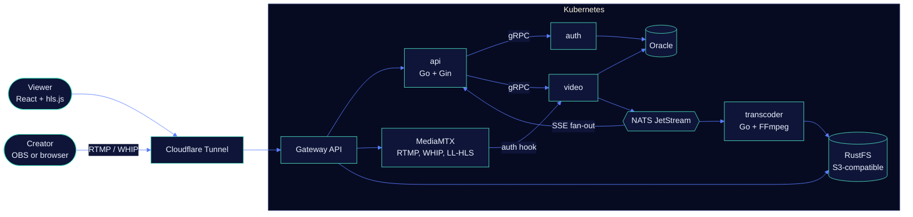

| Problem | Decision |
| --- | --- |
| Multi-gigabyte uploads fail halfway on a home connection | The browser uploads straight to S3-compatible storage in 50 MB parts with presigned URLs; a dropped part retries on its own. |
| A transcode job is lost when the worker restarts | Jobs go through NATS JetStream and stay there until the transcoder acknowledges them: `UPLOADED → PROCESSING → READY` (or `FAILED` with a reason). |
| Danmaku must reach viewers connected to any API pod | VideoService publishes every message on NATS; each gateway pod streams it to its own viewers over Server-Sent Events. |
| Nobody should broadcast on someone else's channel | MediaMTX asks VideoService through an auth hook; stream keys are stored as hashes, browser broadcasts use a 5-minute token. |

> **Coming from Node.js?** The Gin gateway plays the role of an Express app, gRPC interceptors work like Express middleware, and GORM is the Go counterpart of Sequelize or Prisma. In Java, the same shape is Spring Cloud Gateway in front of Spring Boot services that call each other over gRPC.

 

<a href="https://github.com/farhantaufikrahman/Llama-Express"></a>

  
  
  

<a href="https://llama.vzkyrielight.my.id">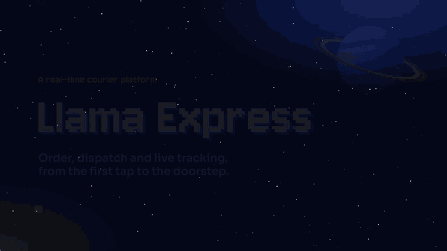</a>

<b>🔭 How Llama Express works</b> &nbsp;(architecture, decisions, Node.js and Go equivalents)

 

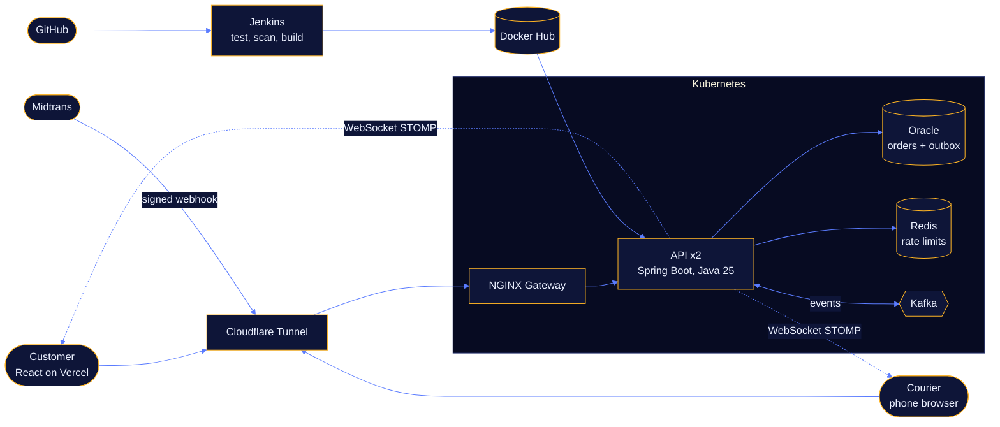

| Problem | Decision |
| --- | --- |
| An order is saved but its event never reaches Kafka | Transactional outbox: the order and its event are written in one transaction; a scheduled publisher forwards events. |
| Two pods, but WebSocket subscribers live in one pod's memory | Each pod consumes status and location events with its own Kafka consumer group and forwards them to its own browsers. |
| Scheduled jobs would run twice after scaling out | ShedLock on the outbox publisher, dispatch sweeper and housekeeping. |
| A bad release reaches the cluster | Jenkins records the running images, rolls out the new SHA, smoke-tests it and restores the previous images on failure. |

> **Coming from Node.js?** Spring Boot controllers map to Express routes, Spring's `@Transactional` replaces manual `BEGIN/COMMIT` with `pg` or Sequelize transactions, and STOMP over WebSocket is the Spring take on Socket.IO rooms. In Go, the same service would be Gin handlers with `segmentio/kafka-go` and a hand-written outbox loop.

 

<a href="https://github.com/farhantaufikrahman/CosFit-FinPrjctHacktiv8"></a>

  
  

<a href="https://github.com/farhantaufikrahman/TripSync-Planner"></a>

  
  

<a href="https://github.com/farhantaufikrahman/Kyriegram-Mobile-InstaClone-"></a>

  
  

## 🧰 Stack

## 📡 Telemetry


## ✨ Flight path


## ☄️ Comet log


  <a href="https://portofolio.vzkyrielight.xyz"></a>

🔧 How this profile is built

 

- Every image is a hand-built, self-contained SVG in the same pixel night-sky style as [my portfolio](https://github.com/farhantaufikrahman/main-portofolio): the Jersey 10 font and the pixel sprites are inlined, because GitHub's image proxy blocks external requests from inside SVGs. Animations are plain CSS and SMIL, and they switch off under `prefers-reduced-motion`.
- `scripts/build_svgs.py` draws the banner, the mission cards, the stack, the flight path and the footer.
- `.github/workflows/sky.yml` runs twice a day: it generates the contribution snake with [Platane/snk](https://github.com/Platane/snk), re-skins it as a comet (`scripts/skin_snake.py`) and draws the telemetry card from the GitHub GraphQL API (`scripts/telemetry.py`). No third-party stats server, so nothing gets rate-limited.

