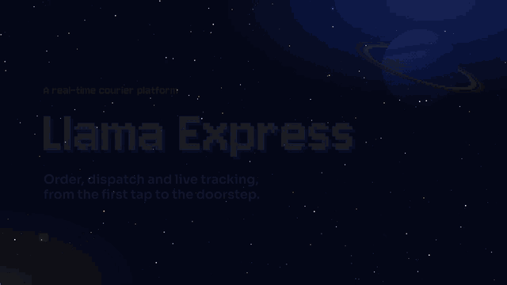
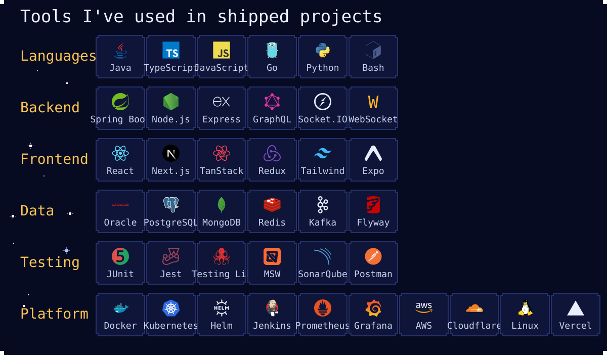

  

  
  
  

## About me

- I build backend and full-stack web apps, mostly with **Java / Spring Boot** and **TypeScript / Node.js**, and I like owning them all the way to production: CI/CD, Kubernetes, monitoring.
- Before software I spent four years in telecom: an Electrical Engineering degree, then network monitoring and incident handling for the **SATRIA-1** national satellite.
- Since the Hacktiv8 full-stack bootcamp (2026) I have been shipping projects full-time. Currently taking **AWS re/Start**.
- Open to **junior software engineer** roles in Jakarta or remote.

## Featured: Llama Express

A real-time courier platform, like GrabExpress: customers book a delivery on a map, nearby couriers are dispatched automatically, and everyone follows the courier live until the package arrives. Built solo, from the first commit to production-style operations.

- **Backend:** Spring Boot 4 on Java 25, Oracle, Kafka with a transactional outbox, Redis, WebSocket (STOMP)
- **Frontend:** React 19 + TypeScript + Leaflet, deployed on Vercel
- **Platform:** 2 backend pods on Kubernetes (Helm), Jenkins CI/CD with automatic rollback, Prometheus + Grafana with 13 alert rules, public API through a Cloudflare Tunnel
- **Tests:** 80+ backend tests (incl. Testcontainers) and 90 frontend tests (Jest, Testing Library, MSW)

[Repository](https://github.com/farhantaufikrahman/Llama-Express) &nbsp;|&nbsp; [Live demo](https://llama.vzkyrielight.my.id) &nbsp;|&nbsp; [Case study on my portfolio](https://portfolio.vzkyrielight.xyz/#llama-express)

## Other projects

| Project | What it is | Stack | Links |
| --- | --- | --- | --- |
| **CosFit** | AI cosplay try-on with Fashn AI, Gemini full-body photo check, community chat and Midtrans payments | Next.js, MongoDB, Socket.IO, Gemini | [Live](https://example.com), [Repo](https://github.com/farhantaufikrahman) <!-- TODO --> |
| **Kyriegram** | Instagram-style mobile app with a GraphQL API and Redis-cached feeds | React Native, Expo, GraphQL, Redis | [Live](https://example.com), [Repo](https://github.com/farhantaufikrahman) <!-- TODO --> |
| **TripSync** | Collaborative travel planner; I built the whole backend, Gemini itinerary suggestions and a chat room per plan | Express, PostgreSQL, Socket.IO, React | [Live](https://example.com), [Repo](https://github.com/farhantaufikrahman) <!-- TODO --> |
| **Waifu Battle** | Card game with MyAnimeList data, Gemini-assisted tactics and Google sign-in | Express, React, PostgreSQL | [Live](https://example.com), [Repo](https://github.com/farhantaufikrahman) <!-- TODO --> |
| **Portfolio** | This pixel night-sky site: Next.js, canvas starfield, interactive architecture diagram | Next.js, React 19, TypeScript | [Live](https://portfolio.vzkyrielight.xyz), [Repo](https://github.com/farhantaufikrahman/portfolio) |

## Stack

## Activity

<picture>
  <source media="(prefers-color-scheme: dark)" srcset="https://raw.githubusercontent.com/farhantaufikrahman/farhantaufikrahman/output/github-snake-dark.svg" />
  <source media="(prefers-color-scheme: light)" srcset="https://raw.githubusercontent.com/farhantaufikrahman/farhantaufikrahman/output/github-snake.svg" />
  
</picture>
